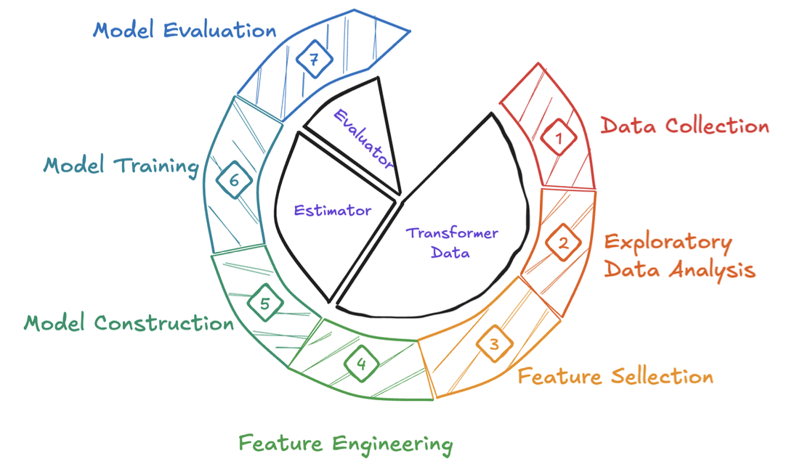

# Multi-Step Water Level Forecasting using LSTM Encoder-Decoder

Research and application of deep learning Sequence-to-Sequence (Seq2Seq) architectures for multi-step water level forecasting at **Le Thuy** hydrological station in Quang Binh, Vietnam.

---

## Overview

Climate change has significantly increased the frequency and intensity of extreme weather events such as heavy rainfall and typhoons, posing severe flood risks for Central Vietnam. Accurate water level forecasting is vital for disaster preparedness, emergency response, and risk management.

Traditional time series forecasting models (e.g., ARIMA) typically assume linearity, limiting their effectiveness in capturing complex hydrological dynamics. This project investigates deep learning architectures:
- **Traditional Baseline LSTM**: Sequential recurrent model predicting future water levels.
- **LSTM Encoder-Decoder (Seq2Seq)**: An autoregressive architecture mapping variable-length historical sequences into multi-step future horizons ($P = 12$ hours ahead) using historical water level, rainfall, and tidal data across connected stations (Kien Giang, Dong Hoi, Le Thuy).

---

## Model Architecture & Workflow

### Workflow


### Architecture


---

## Experimental Results

Comparison between **Traditional LSTM** and **LSTM Encoder-Decoder** on test datasets:

| Metric | Traditional LSTM | LSTM Encoder-Decoder | Improvement |
|:-------|:----------------:|:--------------------:|:-----------:|
| **MAE** | 0.2985 | **0.1048** | ~65% reduction |
| **MSE** | 0.3034 | **0.0568** | ~81% reduction |
| **RMSE** | 0.5508 | **0.2383** | ~57% reduction |
| **R²** | 0.7072 | **0.9447** | +23.75 points |

---

## Project Structure

```text
.
├── configs/                     # Configuration parameters
├── data/                        # Hydrological datasets
│   ├── DataRaw/                 # Original CSV logs (2020-2024)
│   ├── DataPre/                 # Cleaned CSV data
│   └── DataScaled/              # Normalized data & fitted scalers (.pkl)
├── logs/                        # Experiment evaluation logs
│   ├── traditional_eval.log
│   ├── traditional_test.log
│   └── encoder_decoder_eval.log
├── models/                      # Saved trained model weights (.keras)
├── reports/
│   └── figures/                 # Evaluation plots and figures
├── src/                         # Source code (PEP 8 compliant)
│   ├── data/                    # Data preparation modules
│   ├── utils/                   # Shared utilities (metrics, visualizer)
│   │   ├── metrics.py
│   │   └── visualization.py
│   ├── traditional/             # Baseline LSTM pipeline
│   │   ├── data_loader.py
│   │   ├── model.py
│   │   ├── train.py
│   │   └── predict.py
│   └── encoder_decoder/         # Seq2Seq LSTM pipeline
│       ├── data_loader.py
│       ├── model.py
│       ├── train.py
│       └── predict.py
├── requirements.txt             # Python environment dependencies
└── README.md
```

---

## Getting Started

### 1. Clone the repository
```bash
git clone https://github.com/nphonghi/lstm-water-level-forecasting.git
cd lstm-water-level-forecasting
```

### 2. Create and activate a virtual environment
```bash
python3 -m venv .venv
source .venv/bin/activate  # On Windows: .venv\Scripts\activate
```

### 3. Install dependencies
```bash
pip install -r requirements.txt
```

---

## Running Experiments

### Baseline Traditional LSTM
```bash
# Train baseline model
python3 -m src.traditional.train

# Run evaluation and generate prediction plots
python3 -m src.traditional.predict
```

### LSTM Encoder-Decoder
```bash
# Train Seq2Seq model with multi-horizon evaluation
python3 -m src.encoder_decoder.train

# Predict on unseen test data (2024)
python3 -m src.encoder_decoder.predict
```

Generated plots are automatically saved in `reports/figures/`, and detailed metrics are logged in `logs/`.
